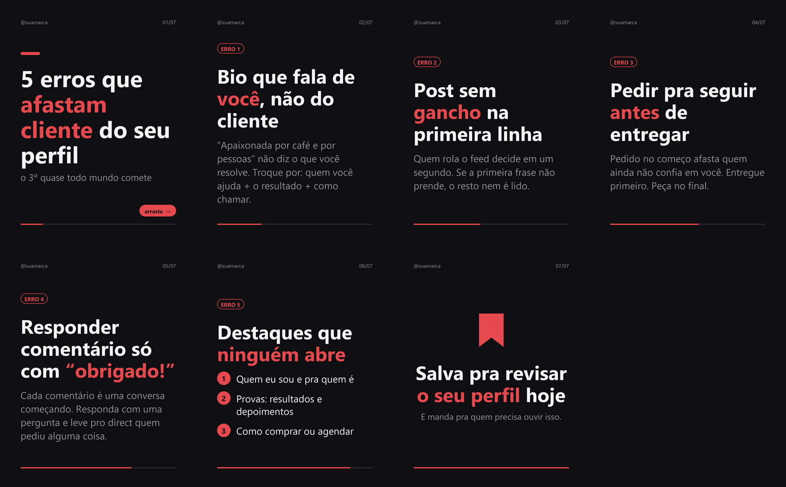

# Time de Conteúdo

**5 skills que transformam o Claude no seu time de conteúdo pro Instagram.** Grátis, código aberto (MIT), rodando no seu computador.

| Skill | Quem é no time | O que entrega |
|---|---|---|
| `reel` | a roteirista | roteiro do Reel: gancho dos 3 primeiros segundos, cena por cena, fala, texto na tela, trilha e capa |
| `carrossel` | a designer | o carrossel escrito **e** renderizado em PNG 1080×1350, da capa ao slide que faz salvar |
| `legenda` | a redatora | a legenda com a primeira linha feita pro trecho antes do "mais", CTA e até 5 hashtags |
| `perfil` | a consultora | auditoria do perfil (nota por item) + 3 bios novas, nome, destaques e fixados |
| `comentarios` | o atendimento | a resposta de cada comentário e a DM de quem pediu algo |



---

## Do que você precisa

- **Claude Code** (vem com o plano Pro ou superior do Claude): [claude.com/claude-code](https://claude.com/claude-code). Funciona no terminal, no app do Claude pra computador (aba Code) e no VS Code.
- **Python 3** com **Pillow**, só pra skill `carrossel` gerar as imagens (`pip install pillow`). As outras 4 não precisam de nada.

Nenhuma skill usa API paga: tudo roda com o seu plano do Claude, no seu computador.

## Instalação (2 comandos)

Abra o Claude Code e digite, um de cada vez:

```
/plugin marketplace add mateusffsc/time-de-conteudo
```

```
/plugin install time-de-conteudo@time-de-conteudo
```

Reinicie o Claude Code. Pronto: as 5 skills estão ativas.

<details>
<summary>Prefere copiar os arquivos na mão?</summary>

**Windows (PowerShell):**
```powershell
git clone https://github.com/mateusffsc/time-de-conteudo "$env:TEMP\time-de-conteudo"
New-Item -ItemType Directory -Force "$env:USERPROFILE\.claude\skills" | Out-Null
Copy-Item "$env:TEMP\time-de-conteudo\skills\*" "$env:USERPROFILE\.claude\skills" -Recurse -Force
```

**Mac / Linux:**
```bash
git clone https://github.com/mateusffsc/time-de-conteudo /tmp/time-de-conteudo
mkdir -p ~/.claude/skills && cp -R /tmp/time-de-conteudo/skills/* ~/.claude/skills/
```

Sem git? Baixe o ZIP (botão verde **Code → Download ZIP**) e copie as 5 pastas de `skills/` para `~/.claude/skills/` (no Windows: `C:\Users\SEU_USUARIO\.claude\skills\`).
</details>

## Primeiro uso

Na primeira vez, a skill faz 6 perguntas sobre a sua marca (@, público, tom, cor…) e guarda as respostas em `~/.claude/time-de-conteudo/marca.md`. Daí em diante, as 5 skills escrevem do seu jeito.

## Como usar

Fale normal com o Claude. Exemplos:

- "Faz um roteiro de reel sobre os 3 erros que fazem o cliente sumir depois do orçamento"
- "Transforma esse texto num carrossel de 7 slides" *(cole o texto ou um link)*
- "Escreve a legenda desse carrossel"
- "Audita meu perfil" *(mande o print)*
- "Responde esses comentários; a palavra é GUIA e o link é ..." *(cole os comentários)*

Se quiser chamar uma skill pelo nome: `/time-de-conteudo:reel`, `/time-de-conteudo:carrossel` etc. (instalação manual: `/reel`, `/carrossel`…).

## Perguntas rápidas

**Ela posta sozinha?** Não. As skills escrevem e geram os arquivos; quem posta e responde é você. Nada acessa a sua conta.

**Precisa saber programar?** Não. Você só conversa com o Claude.

**Posso mudar?** Pode. Cada skill é um arquivo `SKILL.md` em português. Edite à vontade (licença MIT).

---

Feito por **Mateus Ferreira** · [@mateus.curta.ia](https://www.instagram.com/mateus.curta.ia/) · conteúdo sobre IA na prática.
